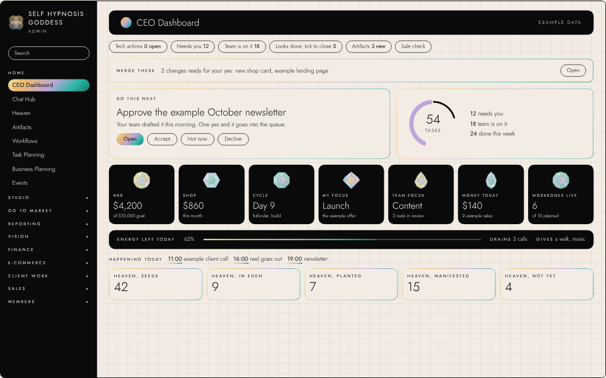

# Bestie, your Chief of Staff agent

**Get shit done, Bestie.** Dump everything in your head. Bestie sorts it into tasks, decisions, rules, questions and ideas, scores it against your end goal, gives every task an owner, and hands you an organised day on your own board.

Built for solo founders, but it works for any business or any busy life: a coach, a shop, an agency, a freelancer, a side project.

## What you get, free

After setup, Bestie gifts you two boards you open every day instead of scrolling a chat.

**Your CEO Dashboard:** do this next, what needs you, your Top 10, today in seven jewels, energy left today


**Your Heaven:** every idea parked by theme, growing from Heaven to Eden to Earth when it ships


Bestie builds them from your brain dumps and keeps them up to date in your Claude Project.

## How to use her (3 minutes)

**Claude.ai (free or paid)**
1. Open [`SKILL.md`](SKILL.md) and click **Copy raw file** (top right).
2. In Claude.ai, click **Projects**, then **New project**, and call it "Bestie".
3. Paste into **Project instructions** and save.
4. Start a chat in that project and send:
```
Hey Bestie, let's set you up.
```
5. Answer her eight short questions. She builds your board at the end, in this style.

Every day after that, open the project and type **morning**, **afternoon** or **evening**, or just brain dump.

**Claude Code:** copy this `bestie` folder into `.claude/skills/` in your project and say "Hey Bestie, let's set you up". She writes your two boards into your project.

## What she does
- Sorts every brain dump in ten steps: catch, split, label, leverage test, rules check, owner, score, Top 10, park, receipt.
- Questions anything that doesn't move your end goal.
- Says "On it" to clear tasks, no lecture.
- Morning brief, afternoon check, evening close, weekly review.
- Remembers your decisions and rules and holds you to them.

See [`EXAMPLE.md`](EXAMPLE.md) for a real voice note and how she sorted it.

## Want a dashboard like mine, all set up?

This is my real CEO Dashboard. It pulls from every report, bot and memory in my business, and a team of 14 AI agents works from it around the clock, with workflows that connect every step.


Want Bestie with your own AI team, a live dashboard and workflows that connect? Contact me, Reshma, for AI architecture and consultancy: [reshmaoracle.com/t/gh-team](https://reshmaoracle.com/t/gh-team).

Made by Reshma Oracle, founder of Self Hypnosis Goddess. Built and trained on Claude. Free to use, MIT licence.
