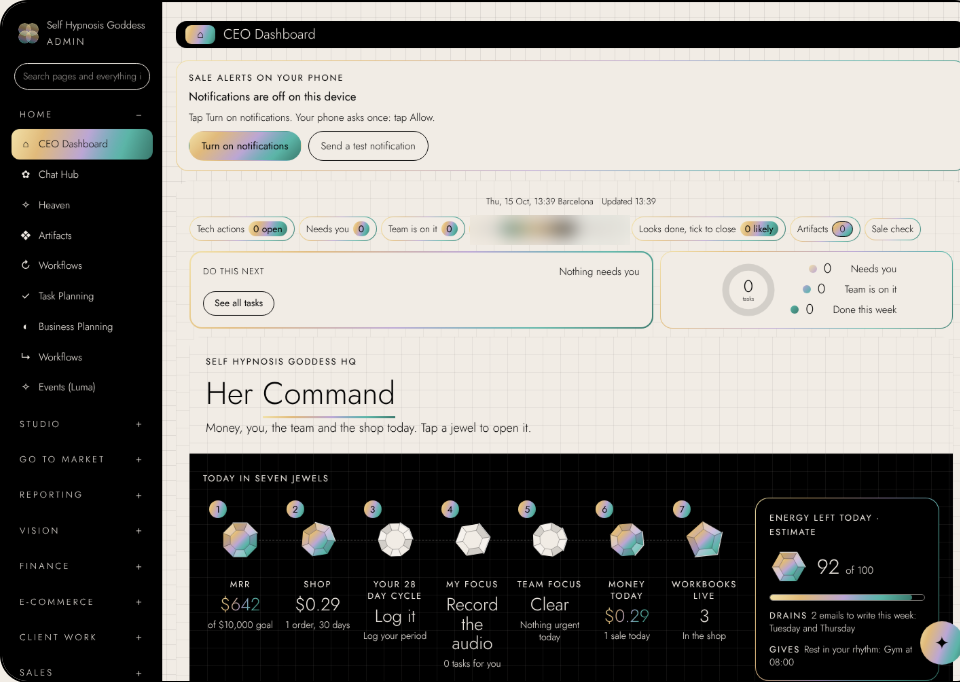
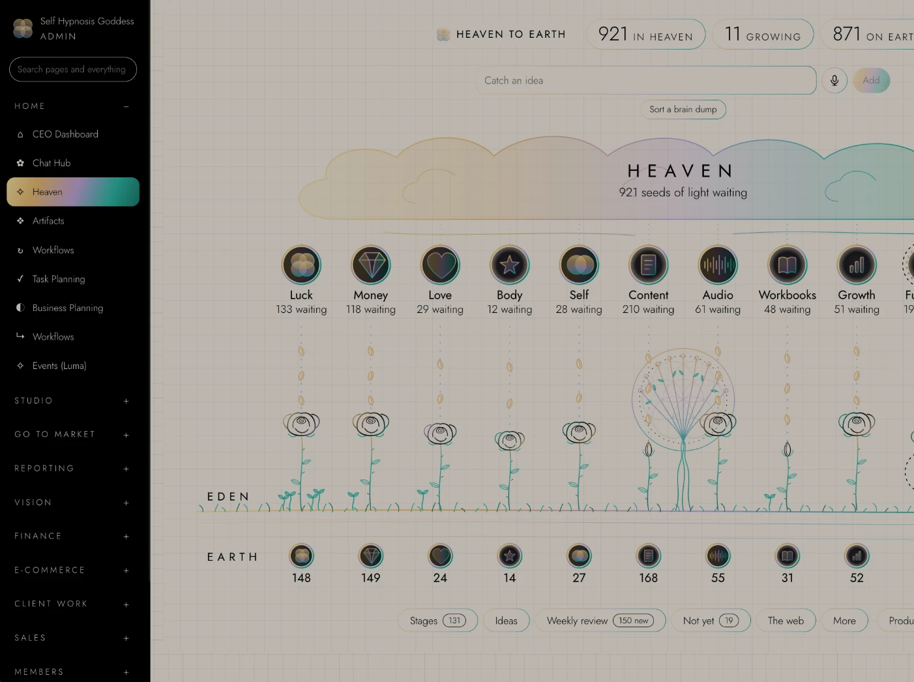
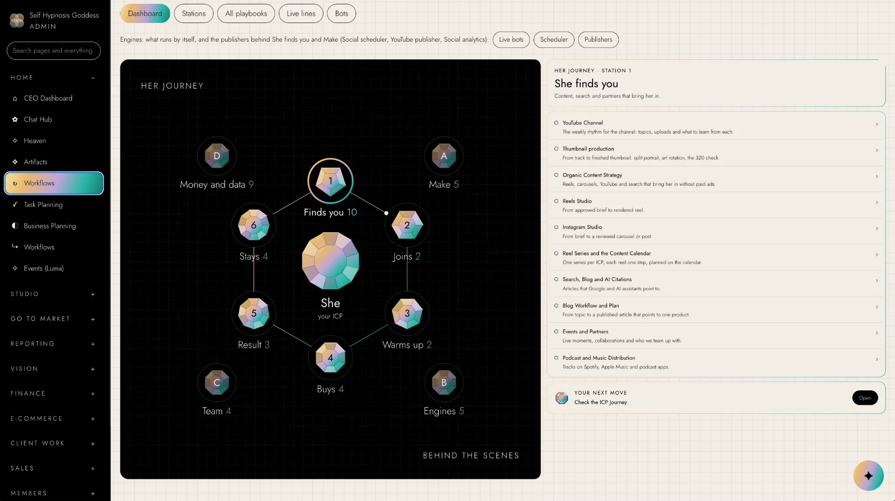
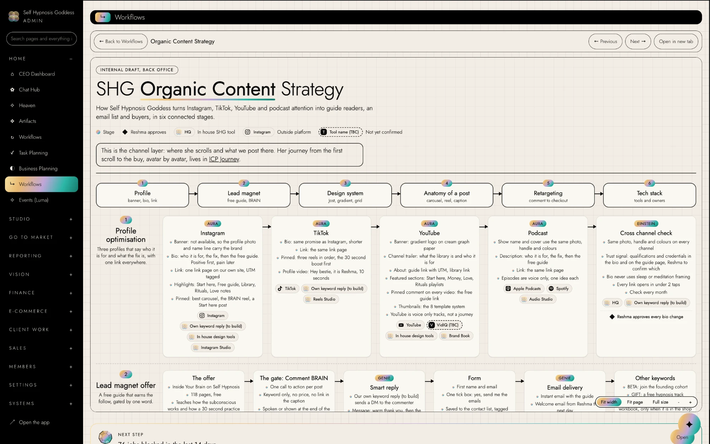
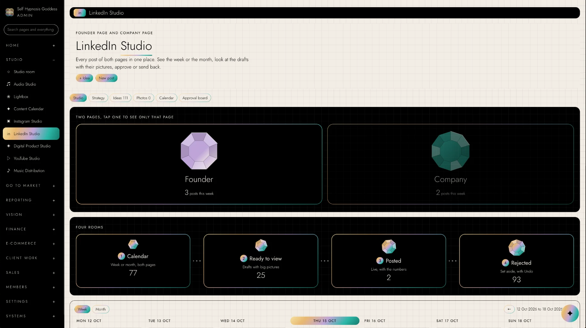

# Bestie, your Chief of Staff agent

**Get shit done, Bestie.** Dump everything in your head. Bestie sorts it into tasks, decisions, rules, questions and ideas, scores it against your end goal, gives every task an owner, and hands you an organised day on your own board.

Built for solo founders, but it works for any business or any busy life: a coach, a shop, an agency, a freelancer, a side project.

## What you get, free: my entire dashboard

I'm giving you my entire CEO Dashboard and my Heaven, for free.

The difference: mine is set up. It runs on my bots, routines, workflows and AI team. Yours starts as just the dashboard, filled by your ideas, your brain dumps and your Heaven. You can set up the rest yourself, or get my help.

**My CEO Dashboard: yours, free**

<a href="screenshots/hq-ceo-dashboard.png"></a>

**Heaven: every idea parked by theme, growing from Heaven to Eden to Earth when it ships**

<a href="screenshots/hq-heaven.png"></a>

Click any picture to see it full size.

## Free Bestie, or a back office like mine?

| | Free Bestie | A back office like mine |
|---|---|---|
| Where the numbers come from | What you tell her in chat | Live from your shop, payments, email, socials and bots |
| Who does the work | You, with Bestie naming the owner | A team of AI agents (I run 14) |
| Dashboard | Updated when you talk to her | Updates itself all day |
| Heaven | Your ideas, sorted | Ideas connected to tasks, workflows and the team |
| Workflows | Not included | Every step written down and connected |

## How to use her (3 minutes)

**Claude.ai (free or paid)**
1. Open [`SKILL.md`](SKILL.md) and click **Copy raw file** (top right).
2. In Claude.ai, click **Projects**, then **New project**, and call it "Bestie".
3. Paste into **Project instructions** and save.
4. Start a chat in that project and send:
```
Hey Bestie, let's set you up.
```
5. Answer her eight short questions. She builds your board at the end, in this style.

Every day after that, open the project and type **morning**, **afternoon** or **evening**, or just brain dump.

**Claude Code:** copy this `bestie` folder into `.claude/skills/` in your project and say "Hey Bestie, let's set you up". She writes your two boards into your project.

## What she does
- Sorts every brain dump in ten steps: catch, split, label, leverage test, rules check, owner, score, Top 10, park, receipt.
- Questions anything that doesn't move your end goal.
- Says "On it" to clear tasks, no lecture.
- Morning brief, afternoon check, evening close, weekly review.
- Remembers your decisions and rules and holds you to them.

See [`EXAMPLE.md`](EXAMPLE.md) for a real voice note and how she sorted it.

## Want a dashboard like mine, all set up?

My dashboard is the same one, but live. It pulls from every report, bot and memory in my business, and a team of 14 AI agents works from it around the clock, with workflows that connect every step.

**My workflows: her journey, station by station, each with its playbooks**

<a href="screenshots/hq-workflows.png"></a>

**One workflow opened: organic content strategy, every channel, owner and tool connected**

<a href="screenshots/hq-organic-strategy.png"></a>

**My LinkedIn Studio: every post, both pages, the week at a glance, drafts with their pictures, approve or send back**

<a href="screenshots/hq-linkedin-studio.png"></a>


Want Bestie with your own AI team, a live dashboard and workflows that connect? Contact me, Reshma, for AI architecture and consultancy: [reshmaoracle.com/t/gh-team](https://reshmaoracle.com/t/gh-team).

Made by Reshma Oracle, founder of Self Hypnosis Goddess. Built and trained on Claude. Free to use, MIT licence.
